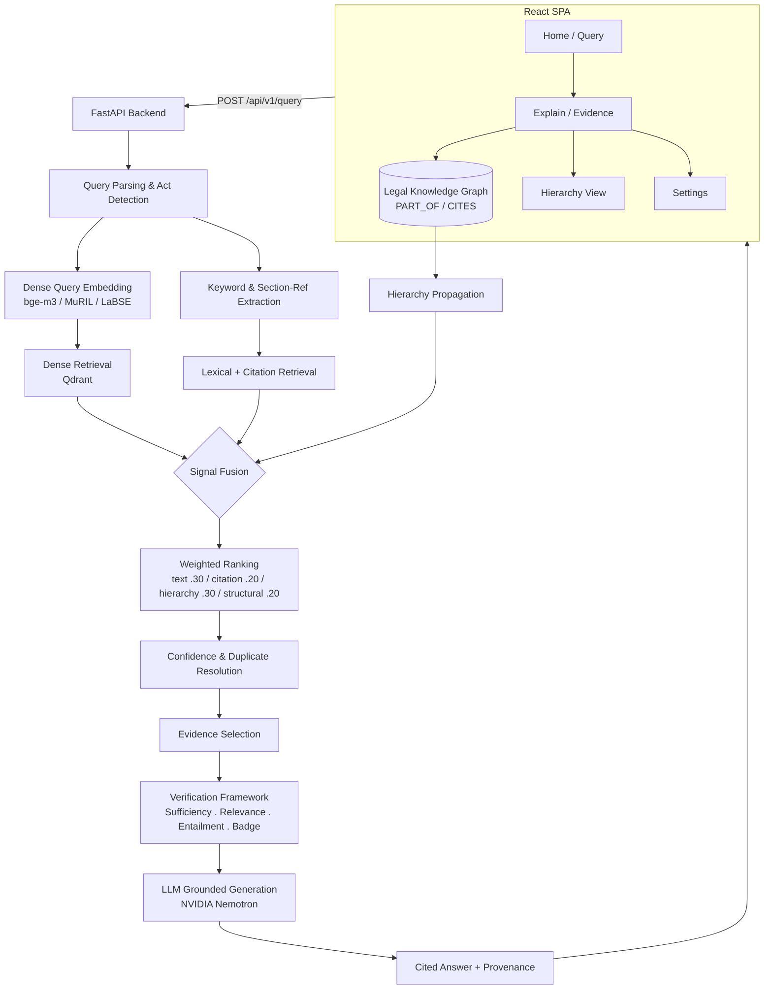

# HHGR — Hybrid Hierarchical Graph Retrieval for Indian Legal Document Intelligence

An **explainable, multilingual question-answering platform** for Indian legal documents. HHGR fuses **dense vector search**, **lexical matching**, **citation analysis**, **hierarchy propagation** and **structural importance scoring** over a legal **knowledge graph**, then grounds every answer in cited, verified evidence with full provenance — so users can see *why* an answer is what it is.

---

## Overview

Indian legal documents — statutes, codes, and judgments — are deeply hierarchical and densely cross-referenced. A single question about theft may require navigating from a general offence definition to specific penalties, cross-referencing illustrations, and distinguishing overruled precedents. Traditional flat, keyword-only retrieval systems miss these structural relationships and frequently produce incomplete or **hallucinated** answers.

HHGR tackles this by:

- **Hybrid retrieval over structure** — combining a hierarchical knowledge graph (Document → Chapter → Section → Clause) with multilingual dense vectors, so both *meaning* and *structure* inform ranking.
- **Explainable AI** — every answer ships with a 6-step reasoning chain, its retrieved evidence, per-signal ranking scores, and a verification trace.
- **Hallucination prevention** — a multi-stage verification framework (sufficiency, relevance, citation entailment, confidence calibration) gates the answer with a verification badge (`supported`, `insufficient_evidence`, `contradicted`, ...).
- **Evidence-grounded generation** — the LLM is constrained to answer from the retrieved, verified evidence and must cite the exact statutory provisions it relies on.

---

## Problem Statement

Legal research assistants must return **precise, correct, and verifiable** answers. Three problems dominate current retrieval-augmented systems for law:

1. **Flat retrieval loses legal structure.** Sections reference other sections; definitions recur across Acts; ambiguous phrases ("steals", "dishonestly", "movable property") carry legal force that bag-of-words is blind to.
2. **Answers are not grounded.** Generic LLM assistants generate fluent but unsupported text, fabricating provisions or conflating repealed law.
3. **Claims cannot be audited.** Legal professionals and litigants need to know *which section supported this claim*, whether the law is still in force, and why the system ranked one provision over another.

HHGR is purpose-built to solve these three problems via a **hierarchical legal knowledge graph**, **four-signal hybrid retrieval**, and a **verification-gated generation pipeline**.

---

## Features

- **Hybrid Hierarchical Graph Retrieval (HHGR)** — fuses text, citation, hierarchy and structural signals with weighted scoring over a legal knowledge graph.
- **Dense multilingual retrieval** — bge-m3 / MuRIL / LaBSE embeddings over Qdrant for semantic search in multiple Indian languages.
- **Hierarchy-aware retrieval** — seed matches propagate to ancestor/descendant provisions along `PART_OF` edges so a Section automatically surfaces its Chapter and related Clauses.
- **Explainability (6-step chain)** — query analysis → candidate generation → scoring → verification → grounded generation → provenance, each step auditable.
- **Full provenance** — every answer returns the exact evidence chunks with node ids, section numbering, document ids and per-signal scores.
- **Knowledge graph** — `PART_OF` (hierarchy) and `CITES` (cross-reference) edges over InMemoryGraph (in-process) or Neo4j (production).
- **Confidence scoring & calibration** — calibrated composite confidence (`entailment 0.35 / relevance 0.30 / sufficiency 0.20 / retrieval 0.15`) with hard caps for contradiction and insufficient evidence.
- **Evidence ranking** — retrieved evidence is ranked for usefulness, not just relevance; low-quality chunks are filtered out.
- **Hallucination prevention** — verification badges, counter-authority markers (overruled / superseded / repealed / void), and retrieval-side LLM deadline to bound latency.
- **Multilingual** — tokenization and embeddings for Hindi, Tamil, Bengali and other Indian languages.
- **NVIDIA Nemotron integration** — production answer generation via `nvidia/nemotron-3-super-120b-a12b` on NVIDIA NIM, with `NVIDIA_MODEL` as the single source of truth for the model name.

---

## System Architecture



---

## Tech Stack

| Category | Technologies |
|----------|-------------|
| **Backend** | Python 3.11+, FastAPI, Pydantic v2, uvicorn |
| **LLM** | NVIDIA NIM — `nvidia/nemotron-3-super-120b-a12b` (OpenAI-compatible) |
| **Vector Store** | Qdrant (cosine similarity, 4 collections: documents / chapters / sections / clauses) |
| **Knowledge Graph** | InMemoryGraph (dev/tests), Neo4j (production) |
| **Embeddings** | bge-m3, LaBSE, MuRIL, IndicBERT (multilingual); deterministic provider for tests |
| **Frontend** | React 18, TypeScript, Vite, Tailwind CSS |
| **Visualization** | Cytoscape.js (knowledge graph), React Flow (hierarchy), Recharts (confidence) |
| **OCR / Ingestion** | PaddleOCR, Tesseract (fallback); PDF / DOCX / TXT loaders |
| **Infrastructure** | Docker, Docker Compose, nginx, Prometheus, Grafana |
| **CI/CD** | GitHub Actions — ruff lint + format, pytest, Vitest, Docker builds |
| **Testing** | pytest (1047 tests), Vitest + Testing Library (53 tests) |

---

## Dataset

The corpus is a set of **hierarchically parsed Indian legal documents**. Raw files are cleaned through the ingestion pipeline (PDF/DOCX/TXT → OCR → cleaning) and parsed by the hierarchy parser into a canonical tree per document.

**Canonical corpus management** — `data/hierarchy/` holds many parser outputs (including duplicates/growth artifacts). The canonical corpus module normalizes each file's Act title and keeps **one canonical file per Act** (highest node/section counts, registered stable ids, newest format), so imports and evaluations are deterministic.

| Act | Coverage |
|-----|----------|
| **Indian Contract Act, 1872 (ICA)** | Registered canonical document; hierarchy of Sections, Chapters and Clauses |
| **Indian Penal Code, 1860 (IPC)** | Registered canonical document; offences, punishment provisions and definitions |
| **Bharatiya Nyaya Sanhita (BNS)** | Successor to IPC — covered in the gold evaluation suite (6 items) |
| **Bharatiya Nagarik Suraksha Sanhita (BNSS)** | Procedural code successor — gold evaluation suite (6 items) |
| **Bharatiya Sakshya Adhiniyam (BSA)** | Evidence law successor — gold evaluation suite (6 items) |

**Document structure** — each Act is parsed into a **Document → Chapter → Section → Clause** tree:

- **Hierarchy:** numbering patterns (20+) parse loose legal formatting into a *nested-set tree* for fast subtree queries.
- **Sections** carry a title and full text; **clauses/illustrations** are attached to their parent section.
- **Illustrations** are preserved and matched contextually alongside the provision text.

**Preprocessing** — the pipeline normalizes Act titles, strips extraneous boilerplate, detects section numbering, and stores the tree as a JSON hierarchy (`nested_set`, `nodes`, `root_id`) that the graph importer converts into `PART_OF`/`CITES` edges.

**Evaluation gold dataset** — 34 QA items: `bns` (6), `bnss` (6), `bsa` (6), `contract_act` (10), `sc_judgments` (6), each with a reference answer and expected citations. See [docs/Dataset.md](docs/Dataset.md).

---

## Retrieval Pipeline

HHGR fuses four complementary signals, all recomputed per query:

| Signal | Role | Default weight |
|--------|------|----------------|
| **Text** | Lexical overlap between query keywords and node content (multilingual tokenization) | 0.30 |
| **Citation** | Legal references in the query (e.g. "Section 378") matched to node numbering or text | 0.20 |
| **Hierarchy** | Activation propagated from seed matches to ancestors/descendants along `PART_OF` edges | 0.30 |
| **Structural** | Node importance (degree + subtree size), normalized per query | 0.20 |

The dense layer adds multilingual semantic search over Qdrant and the two layers are fused with configurable weights (defaults: **dense 0.40 / graph 0.35 / hierarchy 0.25**). The pipeline:

1. **Query parsing** — detect the Act, extract legal references, tokenize (multilingual).
2. **Candidate generation** — dense (semantic) + lexical/citation candidates.
3. **Hierarchy propagation** — enrich candidates with related ancestors/descendants.
4. **Signal fusion & ranking** — weighted composite score, deterministic tie-breaks.
5. **Confidence & deduplication** — duplicate nodes resolved; confidence computed over retrieval evidence.
6. **Evidence selection** — top-k grounded for downstream verification and generation.

---

## Explainability

Every answer is explainable end-to-end:

- **6-step reasoning chain** returned with each query (`intent`, `retrieval_strategy`, expansion, ranking, verification, generation).
- **Verification badges** — a 5-priority rule engine emits one of `supported`, `insufficient_evidence`, `contradicted`, `no_evidence`, `no_answer`.
- **Verification stages** — evidence *sufficiency* (bigram Dice coefficient), *relevance* (LLM judge with deterministic fallback), *entailment* (claim-level), then *badge* and *calibration*.
- **Confidence formula** — `0.35 × entailment + 0.30 × relevance + 0.20 × sufficiency + 0.15 × retrieval_base`; hard rules cap contradiction at 0.20 and insufficient evidence at 0.45.
- **Counter-authority detection** — overruled / superseded / repealed / void markers per provision.
- **Full provenance** — node ids, section numbering, document ids, per-signal scores (`ranking_breakdown`), and an HTTP endpoint to re-fetch any past provenance blob.

---

## Installation

### Prerequisites

- Python 3.11+
- Node.js 20+ (frontend)
- Docker + Docker Compose (full-stack deployment)
- NVIDIA API key (for live LLM answers; the system runs offline with the **mock** provider otherwise)

### Backend

```bash
git clone https://github.com/Krishsuthar91/indian-legal-graphrag.git
cd indian-legal-graphrag

python -m venv .venv
.venv\Scripts\activate        # Windows
# source .venv/bin/activate  # Linux/macOS

pip install -r requirements.txt
```

### Environment variables

All configuration is read from `deploy/env/`. The settings loader resolves in this order:

1. Code defaults (`src/config/settings.py`)
2. `deploy/env/.env.development` (tracked template)
3. `deploy/env/.env.development.local` (git-ignored — **put real secrets here**)
4. OS environment variables (override everything)

```bash
# Copy the tracked template, then edit with your real values
cp deploy/env/.env.development deploy/env/.env.development.local
```

Key variables:

| Variable | Purpose |
|----------|---------|
| `LLM_PROVIDER` | `nvidia` (production) or `mock` (offline) |
| `NVIDIA_API_KEY` | Real key goes in `.env.development.local` — never commit it |
| `NVIDIA_MODEL` | **Single source of truth** for the NVIDIA model (`nvidia/nemotron-3-super-120b-a12b`) |
| `LLM_API_KEY` / `LLM_BASE_URL` | Generic OpenAI-compatible overrides (win over NVIDIA key/base URL when both set) |
| `QDRANT_URL` / `QDRANT_IN_MEMORY` | Vector store endpoint / in-memory mode |
| `NEO4J_URI` / `NEO4J_USER` / `NEO4J_PASSWORD` | Production knowledge graph connection |
| `API_KEY_AUTH_ENABLED` / `API_KEY` | Protect write/administrative endpoints in production |
| `QA_TOP_K`, `QA_REQUEST_TIMEOUT_SECONDS` | Retrieval depth and overall QA deadline |

> **Model note:** `NVIDIA_MODEL` is the model's single source of truth — the generic `LLM_MODEL` never overrides it, while `LLM_*` still wins for API key/base URL. Retired model ids get `HTTP 410` from NVIDIA NIM (e.g. `meta/llama-3.3-70b-instruct` reached EOL on 2026-08-26). See [final_report_llm_model_config.md](final_report_llm_model_config.md).

### Frontend

```bash
cd ui
npm install
npm run dev          # http://localhost:5173
```

### Docker (Full Stack)

```bash
docker compose up --build     # backend + frontend + Neo4j + Redis + Qdrant + nginx
```

### Running locally

```bash
uvicorn src.main:app --reload           # backend at http://localhost:8000/docs
python scripts/run_final_evaluation.py  # offline benchmark report
python -m pytest -q                     # 1047 backend tests
cd ui && npm run test                    # 53 frontend tests
```

---

## API Endpoints

All endpoints are under `http://localhost:8000` — interactive docs at `/docs` (Swagger).

| Method | Path | Description |
|--------|------|-------------|
| `GET` | `/` | Service banner |
| `POST` | `/api/v1/query` | Ask a legal question; returns cited, verified answer + provenance |
| `POST` | `/api/v1/explain` | Retrieve-only explanation (candidates, rankings, signals) |
| `GET` | `/api/v1/provenance/{id}` | Re-fetch a saved provenance blob by id |
| `POST` | `/api/v1/documents/upload` | Upload a PDF/DOCX/TXT legal document and index it |
| `GET` | `/api/v1/health` | Liveness + provider/status summary |
| `GET` | `/api/v1/ready` | Readiness (corpus loaded) |
| `GET` | `/api/v1/live` | Liveness detail |
| `GET` | `/api/v1/check/database` | Database (KG) health |
| `GET` | `/api/v1/check/vector` | Vector store health |
| `GET` | `/api/v1/check/llm` | LLM provider health |

See [docs/API.md](docs/API.md) for full schemas and examples.

---

## Screenshots

*Screenshot placeholders — insert captures from a running instance.*

| | |
|---|---|
|  |  |
|  |  |
|  |  |

---

## Example Queries

| Query | What the system does |
|-------|---------------------|
| "What is theft?" | Expands the concept, retrieves the theft definition + related penalty provisions, verifies and answers with citations |
| "What is murder?" | Retrieves the murder provision (BNS 103 / IPC successor), illustrates the chain of sections |
| "Difference between theft and robbery" | Retrieves both provisions, highlights the escalation elements in the explanation |
| "Explain IPC Section 378" | Act + section detection → exact-section retrieval → explained answer with full text |
| "What is cheating?" | Concept expansion → definition retrieval → verified answer with supporting clauses |
| "What is punishment for theft?" | Penalty provision retrieval via hierarchy (offence → punishment) |
| "Can theft become robbery?" | Cross-references theft + robbery sections using CITES edges and illustration matching |

---

## Performance

Benchmark on the **Indian Contract Act 1872** gold set (before/after the hierarchy-parser fix):

| Metric | Before parser fix | After parser fix |
|--------|-------------------|------------------|
| Overall score | 0.4185 | **0.6271** |
| Section accuracy | 0.1111 | **0.8700** |
| MRR | 0.0370 | **0.7400** |
| Recall@5 | 0.0556 | **0.3316** |
| Hallucination rate | 0.5008 | **0.7883** (grounded) |
| Grounding accuracy | 1.0000 | **1.0000** |
| Avg latency | 2909 ms | **108 ms** |

Confidence calibration ECE: **0.1792**. The full breakdown and reproduction steps are in [docs/Evaluation.md](docs/Evaluation.md) and `results/evaluation_report.md` (regenerate with `python -m scripts.run_final_evaluation`).

---

## Future Work

- **Court Judgments** — precedent/judgment hierarchy ingestion with citation-chain analysis.
- **Multilingual expansion** — evaluate Hindi, Tamil and Bengali corpora with MuRIL/IndicBERT.
- **Cross-lingual QA** — ask in one language, answer grounded in another.
- **Citation generation** — automated pinpoint citations at claim level.
- **Graph neural networks** — learned node embeddings over `PART_OF`/`CITES` structure.
- **Confidence calibration** — temperature-scaled calibration across more domains.

---

## Documentation

| Document | Description |
|----------|-------------|
| [Architecture](docs/ARCHITECTURE.md) | System architecture and deployment topology |
| [Architecture Diagram](docs/architecture/legalgraphrag.architecture.html) | Interactive explorable architecture visualization |
| [Verification Framework](docs/VerificationFramework.md) | Multi-stage verification pipeline details |
| [Evaluation](docs/Evaluation.md) | Benchmark methodology and results |
| [Dataset](docs/Dataset.md) | Evaluation datasets and gold standards |
| [API Reference](docs/API.md) | REST API endpoint documentation |
| [Deployment](docs/DEPLOYMENT.md) | Docker and production deployment guide |
| [Developer Guide](docs/DEVELOPER.md) | Local setup, testing, code conventions |
| [Troubleshooting](docs/TROUBLESHOOTING.md) | Common issues and solutions |
| [Configuration](docs/Configuration.md) | Environment variables, provider priority, setting groups |
| [GitHub Actions](docs/GitHubActions.md) | CI/CD workflows, local equivalence, adding jobs |
| [Startup Hang Root Cause](ROOT_CAUSE_STARTUP_HANG.md) | Cold-start snapshot + deferred prewarm fix |
| [LLM Config Report](final_report_llm_model_config.md) | NVIDIA model precedence, EOL analysis, before/after evidence |
| [Full Project Report](docs/report/01_Project_Overview.md) | 21-part deep-dive: architecture, retrieval, evaluation, limitations |

---

## Acknowledgements

Built with [FastAPI](https://fastapi.tiangolo.com/), [Qdrant](https://qdrant.tech/), [Neo4j](https://neo4j.com/), [React](https://react.dev/), and [NVIDIA NIM](https://build.nvidia.com/). Legal corpus sourced from publicly available Indian statute texts.

## License

MIT License. See [LICENSE](LICENSE) for details.